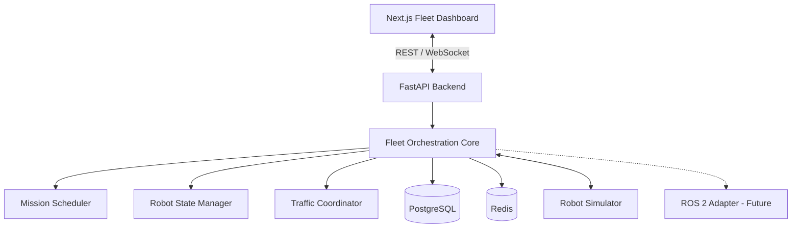

# Robotics Fleet Manager

An open-source robotics fleet management platform for autonomous mobile robots (AMRs), featuring mission orchestration, real-time monitoring, intelligent task scheduling, robot simulation, and scalable fleet coordination.

> **Status:** Early development — architecture and specifications are being prepared. Features described below are planned unless explicitly marked as implemented.

## Overview

Robotics Fleet Manager is a software engineering project exploring how autonomous mobile robots can be coordinated in environments such as warehouses, logistics centers, and industrial facilities.

The goal is to build a reliable fleet orchestration platform that can assign missions, track robot health, coordinate shared resources, and recover from operational failures.

The first implementation will use simulated robots. Integration with physical robots and ROS 2 is a future objective.

## Project classification

- Robotics and Autonomous Systems
- Distributed Systems
- Fleet Orchestration
- Real-Time Monitoring
- Operations Research and Scheduling
- Digital Twin and Simulation
- Optional Agentic AI and Multi-Agent Systems

## Planned capabilities

| Capability | Description |
|---|---|
| Robot registry | Register and manage robots and their capabilities |
| Fleet monitoring | Monitor robot position, battery, connectivity, and status |
| Mission management | Create, assign, execute, cancel, and track missions |
| Task scheduling | Assign missions based on availability and operational constraints |
| Robot simulation | Simulate robot movement, battery consumption, and failures |
| Traffic coordination | Manage shared routes and restricted warehouse zones |
| Event streaming | Publish fleet updates to the dashboard |
| Operational recovery | Detect offline robots and recover interrupted missions |
| Observability | Monitor application health, performance, and fleet events |
| Security | Authenticate operators and authorize sensitive operations |

## Technology stack

| Layer | Technology |
|---|---|
| Frontend | Next.js, React, TypeScript, Tailwind CSS |
| Backend | Python 3.12, FastAPI, Pydantic |
| Python environment | Pixi |
| Database | PostgreSQL, SQLAlchemy, Alembic |
| Cache and coordination | Redis |
| Real-time dashboard | WebSockets |
| Robot simulation | Python |
| Robot integration (future) | ROS 2, MQTT |
| Containerization | Docker Compose |
| Testing | Pytest, Playwright |
| CI/CD | GitHub Actions |

## High-level architecture



## Repository structure

```text
robotics-fleet-manager/
├── apps/
│   ├── frontend/
│   └── backend/
├── services/
│   └── robot-simulator/
├── packages/
│   └── shared-schemas/
├── infrastructure/
│   └── docker/
├── docs/
│   └── ADR/
├── tests/
├── pixi.toml
├── requirements.txt
├── compose.yaml
├── .env.example
├── .gitignore
├── CONTRIBUTING.md
├── LICENSE
└── README.md
```

## Getting started

### Prerequisites

- Git
- Python 3.12 (optional when using Pixi)
- Pixi
- Node.js LTS
- Docker Desktop

### Clone repository

```bash
git clone https://github.com/HamzaAhmedKhan786/robotics-fleet-manager.git
cd robotics-fleet-manager
```

### Install Python dependencies with Pixi

Once `pixi.toml` is available:

```bash
pixi install
pixi run python --version
```

### Start infrastructure

Once `compose.yaml` is configured:

```bash
docker compose up -d
```

### Start backend

After the backend application is implemented:

```bash
pixi run backend
```

### Start frontend

After the Next.js application is initialized:

```bash
cd apps/frontend
npm install
npm run dev
```

## Documentation

- [Project Overview](docs/01-PROJECT-OVERVIEW.md)
- [Requirements](docs/02-REQUIREMENTS.md)
- [Architecture](docs/03-ARCHITECTURE.md)
- [System Design](docs/04-SYSTEM-DESIGN.md)
- [API Design](docs/05-API-DESIGN.md)
- [Database Design](docs/06-DATABASE-DESIGN.md)
- [Robot Simulation](docs/07-ROBOT-SIMULATION.md)
- [Mission Scheduling](docs/08-MISSION-SCHEDULING.md)
- [Safety and Security](docs/09-SAFETY-AND-SECURITY.md)
- [Testing Strategy](docs/10-TESTING-STRATEGY.md)
- [Deployment](docs/11-DEPLOYMENT.md)
- [Development Roadmap](docs/12-DEVELOPMENT-ROADMAP.md)

## Safety disclaimer

This project is initially a simulation and research platform. It is not certified for safety-critical control of physical robots. Physical deployment would require additional validation, risk assessment, safety engineering, and hardware-specific safeguards.

## License

MIT — see [LICENSE](LICENSE).
