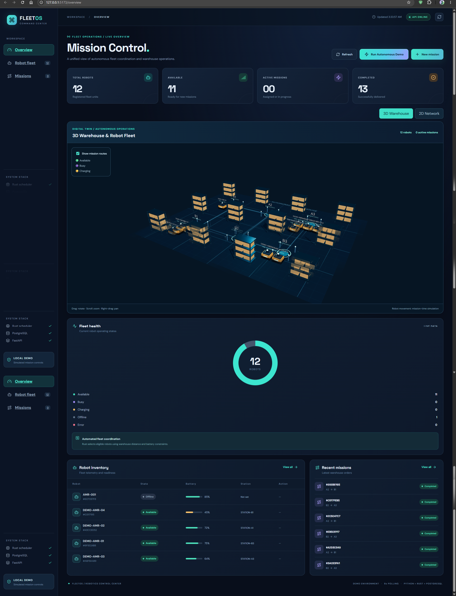

# Project Overview — FleetOS

## Vision

Develop a modular autonomous mobile robot (AMR) fleet management platform that coordinates warehouse deliveries and exposes the decision process through a visual digital twin. The initial scope is software simulation, not physical robot control.

## Problem

Multiple warehouse robots compete for tasks and constrained resources. Dispatching must respect position, battery safety reserve, availability and mission priority. A central view makes queue and scheduling decisions inspectable, while simulation supports repeatable experiments without hardware.

## Solution and current implementation

FleetOS combines a React/TypeScript/Vite command center, FastAPI REST service, PostgreSQL persistence, asynchronous mission worker, Rust PyO3 candidate selector and a six-station warehouse graph. Users create pickup-to-delivery missions; the worker assigns eligible robots and simulates completion. The UI shows status cards, priority queues, route explanations, and interactive 2D/3D scenes. Mission-timed cart movement is visual only and not backend-authoritative telemetry.

## Target users

- Warehouse operators exploring fleet orchestration
- Robotics engineers reviewing dispatch and path-planning logic
- Software engineers evaluating Python/Rust systems integration
- Researchers prototyping multi-robot coordination

## MVP achieved and limitations

A local demonstration has shown more than five registered simulated robots and multiple completed missions. Capabilities implemented: registry, mission lifecycle, a deterministic Rust selector, priority queue, battery/distance feasibility estimates, and interactive visualizations. Current gaps: durable tick-by-tick positions, traffic reservations, physical telemetry, authentication and production-safe deployment.

## Product rules

- Registration is an explicit user operation; **demo never provisions robots**.
- Target capacity: maximum **15 robots**, requiring backend enforcement on all registration paths.
- Pending missions wait when no candidate is eligible; completion releases capacity.
- LLMs and agentic tooling are optional future operator-facing helpers, never replacement for safety checks.

## Next milestone

Expand Rust from candidate selection to pathfinding, energy feasibility and deterministic motion steps; persist coordinates/progress and render frontend motion from backend telemetry (Option B). Then add traffic coordination, fault recovery and observational metrics.

## Boundaries

No claims are made about collision-free traffic, validated real-world energy use, ROS 2 support, safety certification or deployment with physical robots.

---

## Original specification retained for traceability (historical baseline)

> **Historical reference, not a statement of current implementation.** The original text below is preserved so that no early requirement, design option, setup explanation, or proposed feature is lost. Where it differs from the current sections above, **the current sections take precedence**. In particular, references to Next.js, 20 robots, WebSocket telemetry, continuous movement, Redis integration, A* navigation, authentication, or physical control may describe earlier proposals rather than implemented behavior. Review original setup commands against the current repository before running them.

# Project Overview

## Vision

Develop an extensible platform for coordinating autonomous mobile robots in warehouse and industrial environments.

## Problem

Operating multiple robots requires coordination of tasks, shared resources, robot availability, communication, and operational recovery.

Without centralized orchestration, robots may be underutilized, missions may conflict, and failures may require manual intervention.

## Proposed Solution

Build a fleet management platform with:

- Centralized mission management
- Robot state monitoring
- Deterministic scheduling
- Robot simulation
- Warehouse visualization
- Operational event tracking
- Fault detection and recovery

## Target Users

- Warehouse fleet operators
- Robotics engineers
- Logistics automation teams
- Robotics software developers
- Researchers studying multi-robot coordination

## MVP

The MVP will demonstrate five or more simulated warehouse robots completing assigned pickup and delivery missions.

## Long-Term Direction

Future extensions may include ROS 2, advanced traffic management, multi-agent optimization, and AI-assisted operations.

## Current Status

Design and initial development. No production deployment or physical robot integration is claimed.
