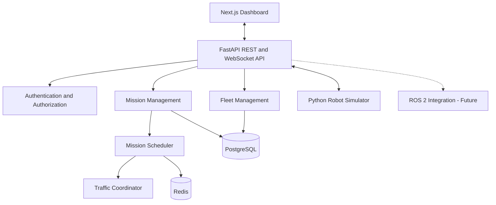

# System Architecture

## 1. Architectural Approach

The initial system follows a modular monolith architecture.

FastAPI hosts the fleet orchestration business logic, while the simulator runs as a separate process.

This avoids premature microservice complexity while preserving clear module boundaries.

## 2. Architecture Diagram

## 3. Architectural Components

### Frontend
- Fleet overview dashboard
- Robot status monitoring
- Mission management interface
- Warehouse map visualization
- Operational alerts

### Backend API
- REST endpoints
- WebSocket event streaming
- Input validation
- Authentication and authorization
- Business orchestration

### Fleet Management
- Robot registration
- Robot capabilities
- Availability tracking
- Robot state management

### Mission Management
- Mission creation
- Lifecycle transitions
- Assignment tracking
- Cancellation and recovery

### Scheduling Engine
- Robot eligibility filtering
- Battery-aware assignment
- Distance-based selection
- Mission priority handling

### Traffic Coordinator
- Warehouse zone reservation
- Shared-path conflict detection
- Reservation expiry and recovery

### Robot Simulator
- Simulated movement
- Battery discharge
- Heartbeat generation
- Mission execution
- Fault injection

## 4. Persistence Strategy

PostgreSQL is the authoritative database for robots, missions, assignments, and audit events.

Redis may be used for:
- Short-lived coordination state
- Cache entries
- Pub/sub notifications
- Rate limiting

Redis must not be the sole source of truth for mission completion or safety-critical state.

## 5. Integration Strategy

The first robot adapter communicates with the Python simulator.

Future adapters may support:
- ROS 2
- MQTT
- Vendor-specific robot APIs

Each adapter must expose a common interface for commands, telemetry, and acknowledgements.

## 6. Safety Boundary

The fleet platform coordinates missions at a high level.

Robot-local systems remain responsible for:
- Emergency stopping
- Obstacle avoidance
- Motion control
- Local navigation safety

AI agents must not bypass deterministic safety constraints.

## 7. Architectural Principles

1. Separate business orchestration from robot control.
2. Keep mission state transitions deterministic.
3. Use persistent records for authoritative state.
4. Design commands to be idempotent.
5. Handle duplicate and delayed telemetry.
6. Prefer modularity before microservices.
7. Make operational behavior observable.
8. Test failure scenarios, not only successful missions.
