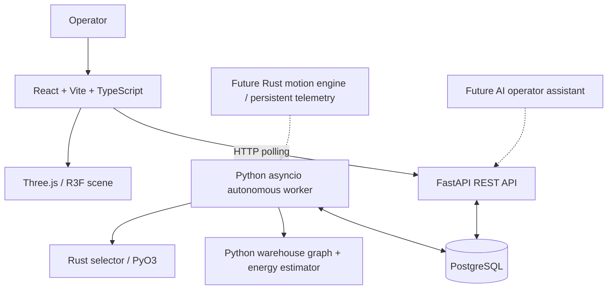
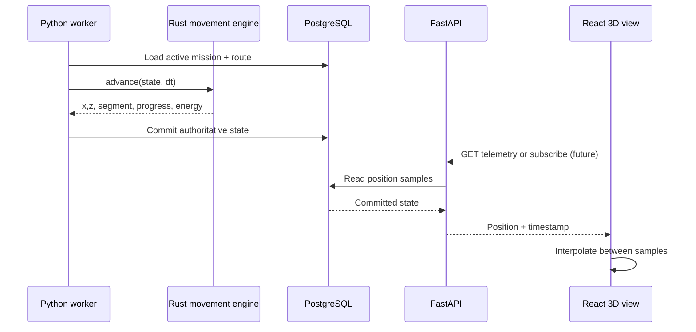
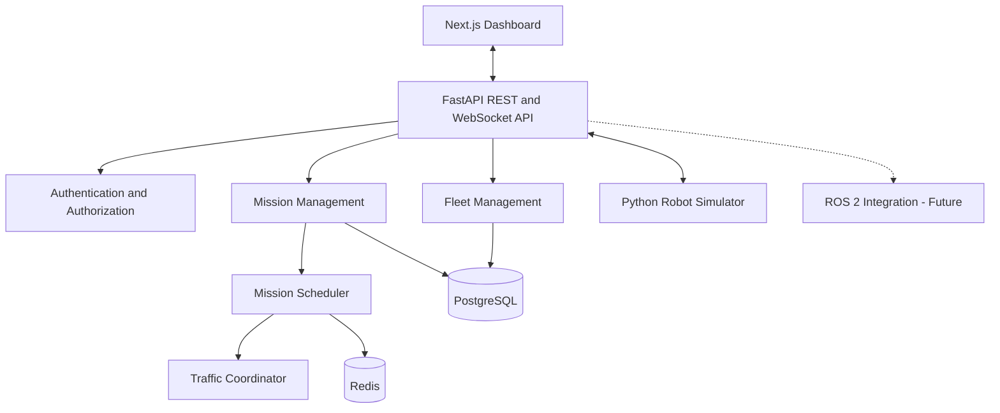

# System Architecture — FleetOS

## Architecture style

FleetOS is a modular monolith for local demonstration. React/Vite supplies the web UI; FastAPI serves REST endpoints and may host one async worker in its development lifespan. PostgreSQL is the source of truth for robots and missions. Rust, compiled by Maturin/PyO3, currently supplies deterministic candidate selection. Routes and energy estimates remain in Python. The 3D digital twin is a viewer, not a physical controller.

## Implemented architecture

## Component ownership

| Layer | Current responsibility | Future |
|---|---|---|
| React | operator screens, 2D graph, 3D visualization, ~2 s polling | streamed telemetry and replay |
| FastAPI | validated robot/mission/fleet/demo APIs, app lifecycle | authorization and event feeds |
| PostgreSQL | durable robot/mission records, saved plan and reason | movement samples, events and reservations |
| Python worker | assign/start/time-complete missions, battery/state transitions | persist Rust-computed movement steps, restart recovery |
| Rust | select feasible robot by pickup distance/battery/ID | graph route, energy, traffic and motion engine |
| Redis | not required for current local prototype | optional event fanout/coordination |
| AI agents | not implemented | optional high-level operations tools |

## Worker lifecycle

1. Read pending missions ordered by priority and age.
2. For each mission, evaluate available candidates and Python route/energy feasibility.
3. Call native Rust selector to choose a candidate deterministically.
4. Transactionally reserve robot and assign mission; record plan/explanation.
5. Mark assigned mission in progress.
6. On elapsed simulated duration, complete mission, deduct estimated battery and release/charge robot.
7. Retry pending missions on subsequent ticks.

The local mode should start **exactly one** worker, either via FastAPI lifespan or a standalone `python -m scripts.auto_worker`, never both. App-integrated workers cannot simply be multiplied across production Uvicorn processes.

## Concurrency and consistency

PostgreSQL transactions and row locks should guarantee one active mission per robot. Two worker instances require explicit leader election/queue ownership; merely having duplicate polling loops is not supported. Registration cap enforcement also needs an atomic count-plus-create operation. Production readiness will require idempotent event handling, retries, audited state transitions, and safe worker recovery.

## Option B target architecture

## Safety boundaries

Current project does not control physical AMRs and does not guarantee collision avoidance. Physical safety (local navigation, emergency stop, obstacle avoidance) belongs on validated robot controllers. AI agents must not bypass deterministic operational checks.

## Related docs

[Requirements](02-REQUIREMENTS.md) · [System design](04-SYSTEM-DESIGN.md) · [Simulation](07-ROBOT-SIMULATION.md) · [Technology ADR](ADR/0001-TECHNOLOGY-STACK.md)

---

## Original specification retained for traceability (historical baseline)

> **Historical reference, not a statement of current implementation.** The original text below is preserved so that no early requirement, design option, setup explanation, or proposed feature is lost. Where it differs from the current sections above, **the current sections take precedence**. In particular, references to Next.js, 20 robots, WebSocket telemetry, continuous movement, Redis integration, A* navigation, authentication, or physical control may describe earlier proposals rather than implemented behavior. Review original setup commands against the current repository before running them.

# System Architecture

## 1. Architectural Approach

The initial system follows a modular monolith architecture.

FastAPI hosts the fleet orchestration business logic, while the simulator runs as a separate process.

This avoids premature microservice complexity while preserving clear module boundaries.

## 2. Architecture Diagram

## 3. Architectural Components

### Frontend
- Fleet overview dashboard
- Robot status monitoring
- Mission management interface
- Warehouse map visualization
- Operational alerts

### Backend API
- REST endpoints
- WebSocket event streaming
- Input validation
- Authentication and authorization
- Business orchestration

### Fleet Management
- Robot registration
- Robot capabilities
- Availability tracking
- Robot state management

### Mission Management
- Mission creation
- Lifecycle transitions
- Assignment tracking
- Cancellation and recovery

### Scheduling Engine
- Robot eligibility filtering
- Battery-aware assignment
- Distance-based selection
- Mission priority handling

### Traffic Coordinator
- Warehouse zone reservation
- Shared-path conflict detection
- Reservation expiry and recovery

### Robot Simulator
- Simulated movement
- Battery discharge
- Heartbeat generation
- Mission execution
- Fault injection

## 4. Persistence Strategy

PostgreSQL is the authoritative database for robots, missions, assignments, and audit events.

Redis may be used for:
- Short-lived coordination state
- Cache entries
- Pub/sub notifications
- Rate limiting

Redis must not be the sole source of truth for mission completion or safety-critical state.

## 5. Integration Strategy

The first robot adapter communicates with the Python simulator.

Future adapters may support:
- ROS 2
- MQTT
- Vendor-specific robot APIs

Each adapter must expose a common interface for commands, telemetry, and acknowledgements.

## 6. Safety Boundary

The fleet platform coordinates missions at a high level.

Robot-local systems remain responsible for:
- Emergency stopping
- Obstacle avoidance
- Motion control
- Local navigation safety

AI agents must not bypass deterministic safety constraints.

## 7. Architectural Principles

1. Separate business orchestration from robot control.
2. Keep mission state transitions deterministic.
3. Use persistent records for authoritative state.
4. Design commands to be idempotent.
5. Handle duplicate and delayed telemetry.
6. Prefer modularity before microservices.
7. Make operational behavior observable.
8. Test failure scenarios, not only successful missions.
