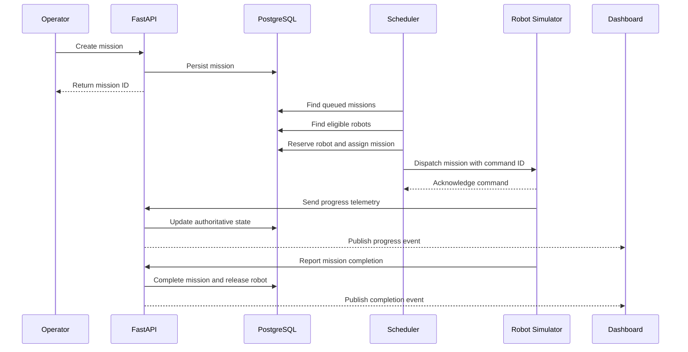
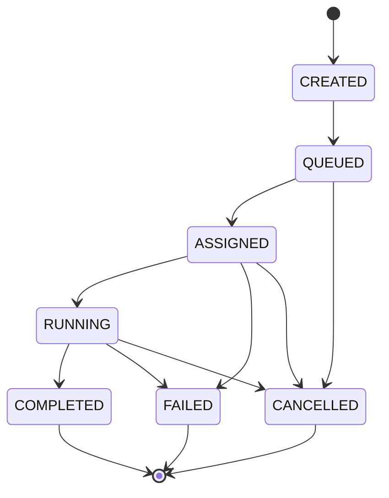

# Detailed System Design

## 1. Overview

The system coordinates simulated autonomous mobile robots in a warehouse using a centralized fleet orchestration service.

The fleet manager is responsible for task assignment, resource coordination, operational state, and recovery. Each robot simulator is responsible for executing its assigned movement.

## 2. Mission Execution Sequence

## 3. Robot State Model

Robot states:

- IDLE
- RESERVED
- MOVING
- CHARGING
- PAUSED
- OFFLINE
- ERROR

Each robot has a unique identifier, current position, battery level, capabilities, and last heartbeat timestamp.

State transitions must be validated. For example, an OFFLINE robot cannot accept a new mission.

## 4. Mission State Model

## 5. Scheduling

The initial scheduler uses deterministic rules:

1. Find queued missions.
2. Identify available robots.
3. Filter by required capabilities.
4. Check battery reserve.
5. Check route and zone availability.
6. Rank eligible robots by estimated travel cost.
7. Atomically reserve the selected robot.
8. Dispatch a uniquely identified mission command.

Only one active mission assignment is permitted per robot in the MVP.

## 6. Concurrency and Consistency

PostgreSQL transactions protect mission assignment.

Use row-level locking or equivalent concurrency control to prevent multiple scheduler workers from assigning the same robot.

Commands require unique identifiers and idempotent processing.

## 7. Failure Handling

### Robot offline
- Detect heartbeat timeout.
- Mark robot unavailable.
- Prevent new assignments.
- Determine mission status.
- Require safe recovery or operator intervention.

### Command timeout
- Retry only when safe.
- Reuse the same idempotency identifier.
- Avoid creating duplicate physical actions.

### Database failure
- Reject unsafe state-changing operations.
- Recover from persisted state.
- Reconcile robot reports after connectivity returns.

## 8. Communication

- REST: configuration, mission creation, queries.
- WebSockets: dashboard updates.
- Simulator adapter: mission commands and telemetry.
- ROS 2/MQTT: future robot integrations.

## 9. Performance

Initial development targets:
- 20 simulated robots
- Approximately one telemetry update per robot per second
- Five concurrently active missions
- Dashboard updates within approximately two seconds under local test conditions

These targets must be validated through testing.
