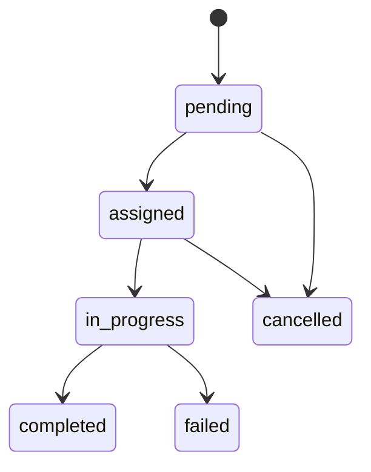
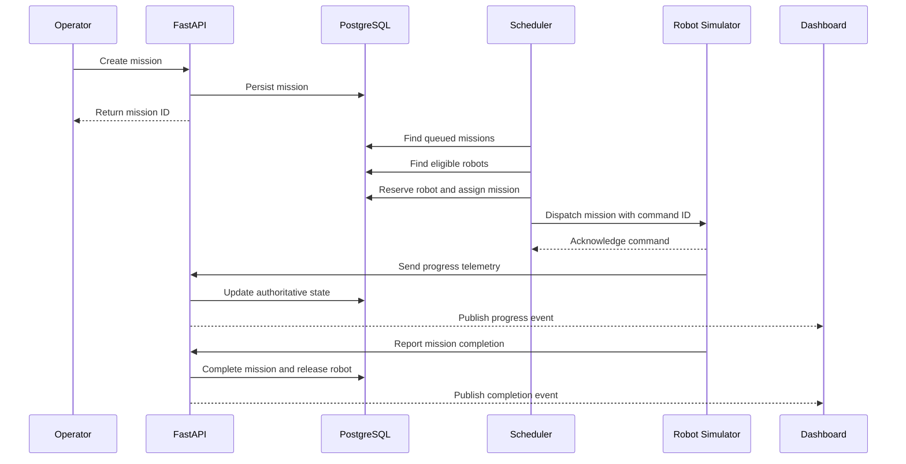
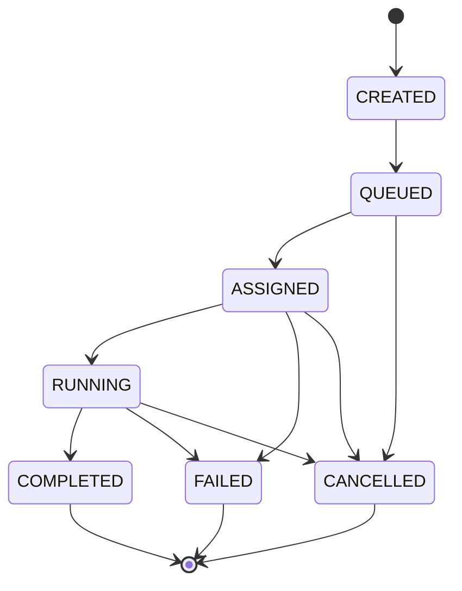

# Detailed System Design — FleetOS

## 1. System boundaries

Simulation-first, six-station warehouse (A1, A2, A3, B1, B2, B3). FastAPI owns HTTP validation and persistence. A Python asyncio worker owns mission lifecycle. A PyO3 extension owns current candidate ranking. The frontend owns presentation only.

## 2. State models

### Robot states (current)

`available`, `busy`, `charging`, `offline`, `error`. Robot stores UUID, name, battery percentage, `current_location` and timestamps. Registration should start offline; activation is explicit. Do not infer true physical position from `current_location`: it is the last committed station.

### Mission states (current)

`pending`, `assigned`, `in_progress`, `completed`, `cancelled`, `failed`. A mission stores pickup/delivery station keys, priority, optional robot UUID, created/updated timestamps, optional `plan` JSON, `selection_reason`, `started_at` and `finished_at`.



Some routes may support additional administrative transitions; verify against current API handlers, not just the diagram.

## 3. Execution sequence (current)

```mermaid
sequenceDiagram
    actor O as Operator
    participant API as FastAPI
    participant PG as PostgreSQL
    participant W as Worker
    participant P as Python planner
    participant R as Rust selector
    participant UI as Dashboard
    O->>API: POST /api/v1/missions
    API->>PG: Save pending mission
    W->>PG: Read queue and free robots
    W->>P: Compute full route + energy feasibility
    W->>R: Rank candidate distances/battery
    R-->>W: Selected robot ID
    W->>PG: Reserve robot; store plan/reason
    W->>PG: Start mission; later complete via time estimate
    UI->>API: Poll summary/robots/missions
    API-->>UI: Current committed state
```

## 4. Warehouse graph

Station identifiers are `STATION-A1` etc. Horizontal/vertical weighted edges are used for shortest paths. Route planning must produce robot-start → pickup → destination and reject disconnected nodes. For visual display, station points are projected into Three.js `(x,z)` floor coordinates, with `y` reserved for height. The **current frontend 3D geometry is presentation**, not a source of routing truth.

## 5. Selection and energy

Current Python planning estimates energy consumption and minimum reserve, rejects infeasible candidates, then passes eligible candidates to Rust. Current Rust ranking: minimum pickup travel distance, maximum battery on ties, stable identifier. Priority affects pending queue order. Numbers are illustrative simulation coefficients and should not be treated as measured battery physics.

## 6. Transaction design

Mission assignment must atomically ensure that both robot availability and mission pending status still hold. Persist selection explanation and route in the same unit of work as assignment. Completion should deduct battery exactly once. Concurrent scheduling tests and transaction isolation checks are necessary for multiple workers.

## 7. Option B — authoritative movement design

Proposed fields: `position_x`, `position_z`, `last_position_at`, `current_segment`, and `progress_percent` (robot and/or mission telemetry). Add migration and versioned API schemas. Rust movement engine receives route geometry, previous simulation state, speed and elapsed time; returns next state deterministically. Python commits the results and publishes them. Frontend interpolates between committed snapshots; completion is based on backend state alone. Include pause/restart/replay and low-battery tests.

## 8. Fleet capacity

Manual registration only, target maximum of 15. No demo provisioning. Implement capacity count+insert atomically in **every** robot registration entrypoint; cap remains unchanged if all robots busy. Missions stay pending until an eligible robot becomes free.

## 9. Non-goals

No authenticated operators or real robot controller in the current prototype; no implemented traffic reservations, fail-safe motors, local perception, or certified safety logic.

---

## Original specification retained for traceability (historical baseline)

> **Historical reference, not a statement of current implementation.** The original text below is preserved so that no early requirement, design option, setup explanation, or proposed feature is lost. Where it differs from the current sections above, **the current sections take precedence**. In particular, references to Next.js, 20 robots, WebSocket telemetry, continuous movement, Redis integration, A* navigation, authentication, or physical control may describe earlier proposals rather than implemented behavior. Review original setup commands against the current repository before running them.

# Detailed System Design

## 1. Overview

The system coordinates simulated autonomous mobile robots in a warehouse using a centralized fleet orchestration service.

The fleet manager is responsible for task assignment, resource coordination, operational state, and recovery. Each robot simulator is responsible for executing its assigned movement.

## 2. Mission Execution Sequence



## 3. Robot State Model

Robot states:

- IDLE
- RESERVED
- MOVING
- CHARGING
- PAUSED
- OFFLINE
- ERROR

Each robot has a unique identifier, current position, battery level, capabilities, and last heartbeat timestamp.

State transitions must be validated. For example, an OFFLINE robot cannot accept a new mission.

## 4. Mission State Model



## 5. Scheduling

The initial scheduler uses deterministic rules:

1. Find queued missions.
2. Identify available robots.
3. Filter by required capabilities.
4. Check battery reserve.
5. Check route and zone availability.
6. Rank eligible robots by estimated travel cost.
7. Atomically reserve the selected robot.
8. Dispatch a uniquely identified mission command.

Only one active mission assignment is permitted per robot in the MVP.

## 6. Concurrency and Consistency

PostgreSQL transactions protect mission assignment.

Use row-level locking or equivalent concurrency control to prevent multiple scheduler workers from assigning the same robot.

Commands require unique identifiers and idempotent processing.

## 7. Failure Handling

### Robot offline
- Detect heartbeat timeout.
- Mark robot unavailable.
- Prevent new assignments.
- Determine mission status.
- Require safe recovery or operator intervention.

### Command timeout
- Retry only when safe.
- Reuse the same idempotency identifier.
- Avoid creating duplicate physical actions.

### Database failure
- Reject unsafe state-changing operations.
- Recover from persisted state.
- Reconcile robot reports after connectivity returns.

## 8. Communication

- REST: configuration, mission creation, queries.
- WebSockets: dashboard updates.
- Simulator adapter: mission commands and telemetry.
- ROS 2/MQTT: future robot integrations.

## 9. Performance

Initial development targets:
- 20 simulated robots
- Approximately one telemetry update per robot per second
- Five concurrently active missions
- Dashboard updates within approximately two seconds under local test conditions

These targets must be validated through testing.
