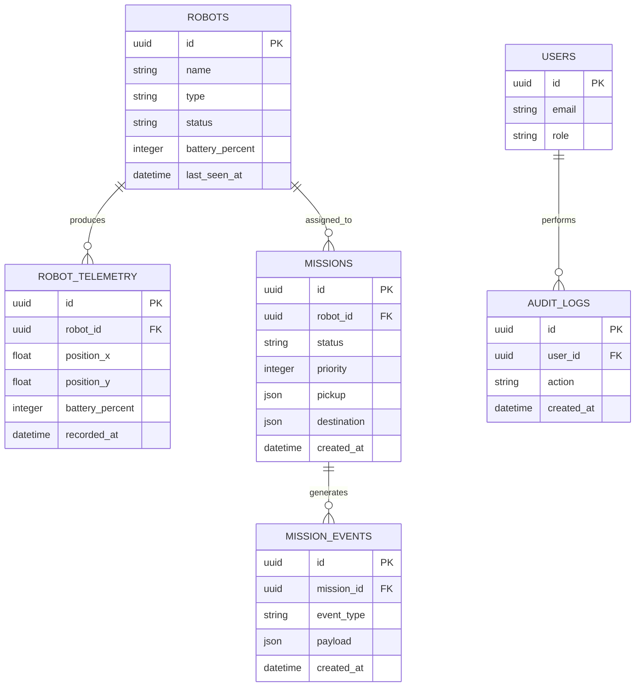

# Database Design

## 1. Database

PostgreSQL is the authoritative persistence layer.

SQLAlchemy manages database models and Alembic manages schema migrations.

## 2. Entity Relationship Diagram

## 3. Data Integrity

- Use UUID primary keys.
- Apply foreign key constraints.
- Validate mission state transitions in application logic.
- Add database constraints for valid battery ranges.
- Index robot status and mission status.
- Index telemetry by robot ID and timestamp.
- Prevent multiple active assignments for the same robot.

## 4. Transactions

Mission assignment must be atomic.

The transaction should:
1. Lock the selected robot.
2. Confirm availability.
3. Reserve the robot.
4. Assign the mission.
5. Record an event.
6. Commit.

External commands should be dispatched after durable persistence, preferably through a transactional outbox pattern.

## 5. Retention

Telemetry retention and archival policies will be defined before production deployment.

Mission and audit history should have separate retention policies.
