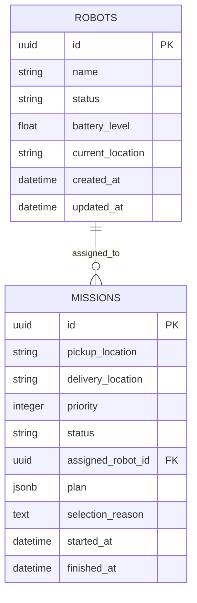
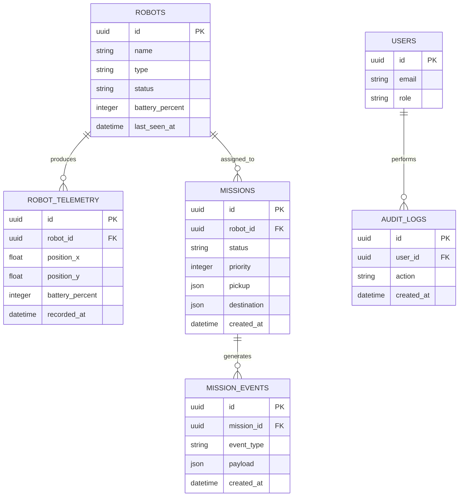

# Database Design — FleetOS

## 1. Persistence

PostgreSQL is authoritative. SQLAlchemy 2 async sessions access database models; Alembic versions schema changes. Local development database: `robotics_fleet`; integration-test database: `robotics_fleet_test` (must be migrated separately). No production telemetry schema is claimed.

## 2. Implemented logical entities

`missions.plan` stores simulation route and estimated energy metadata. Nullability, default values and constraint details should be verified in the migration files. The frontend's cart geometry is **not** a stored position.

## 3. Integrity requirements

- UUID primary keys and mission robot FK.
- Validate battery between 0 and 100 and station membership.
- Enforce legal robot and mission status values.
- Prevent a robot from having multiple active assignments through lock-protected transactions; consider a partial unique index or explicit invariant validation.
- Registering a robot must not exceed the target 15-robot cap. Use an atomic count-and-insert operation coordinated with other registration requests.
- Do not change registration cap simply because current robots are busy.
- Mission completion and battery deduction must be idempotent.

## 4. Current transactions

Assignment service locks/validates candidate and mission states, records plan/explanation, marks robot busy and commits. Completion updates robot battery/location and mission terminal state. These are application-level guarantees requiring concurrency and repeatability tests.

## 5. Proposed Option B schema — not implemented

- `robot_positions` or robot fields: `position_x`, `position_z`, `segment_index`, `last_position_at`.
- `mission_execution` fields: `progress_percent`, `last_tick_at`, `simulation_speed`, `simulation_version`.
- Optional append-only `robot_telemetry` history keyed by robot and timestamp.
- `mission_events` audit/event stream and `route_reservations` table for conflict avoidance.

Version movement state migrations and retain compatibility with existing records. Avoid rewriting `current_location` per animation frame unless the field explicitly changes meaning: station ID is different from continuous coordinates.

## 6. Concurrency and recovery

On worker restart, reload active missions with committed timestamps and resume deterministically. For multiple workers, add exclusive ownership or leases rather than relying only on local tasks. Consider an outbox for external events. PostgreSQL remains the durable authority; Redis, if adopted, is auxiliary.

## 7. Retention

Define telemetry retention, compaction and audit policies before enabling high-frequency writes. Prevent tests from deleting production data by keeping the separate test DB fixture and migration target explicit.

---

## Original specification retained for traceability (historical baseline)

> **Historical reference, not a statement of current implementation.** The original text below is preserved so that no early requirement, design option, setup explanation, or proposed feature is lost. Where it differs from the current sections above, **the current sections take precedence**. In particular, references to Next.js, 20 robots, WebSocket telemetry, continuous movement, Redis integration, A* navigation, authentication, or physical control may describe earlier proposals rather than implemented behavior. Review original setup commands against the current repository before running them.

# Database Design

## 1. Database

PostgreSQL is the authoritative persistence layer.

SQLAlchemy manages database models and Alembic manages schema migrations.

## 2. Entity Relationship Diagram

## 3. Data Integrity

- Use UUID primary keys.
- Apply foreign key constraints.
- Validate mission state transitions in application logic.
- Add database constraints for valid battery ranges.
- Index robot status and mission status.
- Index telemetry by robot ID and timestamp.
- Prevent multiple active assignments for the same robot.

## 4. Transactions

Mission assignment must be atomic.

The transaction should:
1. Lock the selected robot.
2. Confirm availability.
3. Reserve the robot.
4. Assign the mission.
5. Record an event.
6. Commit.

External commands should be dispatched after durable persistence, preferably through a transactional outbox pattern.

## 5. Retention

Telemetry retention and archival policies will be defined before production deployment.

Mission and audit history should have separate retention policies.
