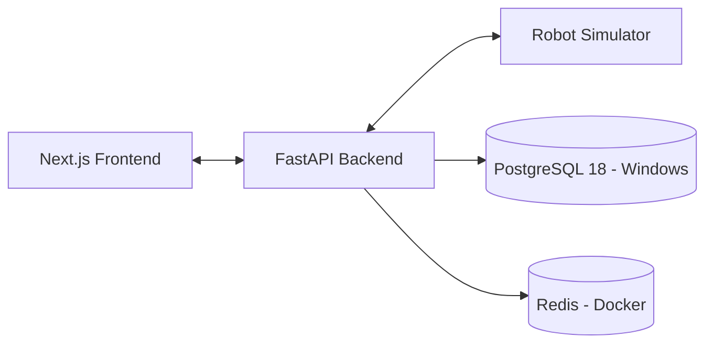

# Deployment Design

## 1. Development Environment

Robotics Fleet Manager supports a hybrid local development environment designed to reduce resource consumption on Windows machines.

The local environment uses:

- **Pixi:** Python environment and dependency management.
- **Node.js:** Next.js frontend development (planned).
- **PostgreSQL 18:** Native Windows service for persistent data storage.
- **Redis:** Dedicated Docker container for caching and temporary state (planned).
- **FastAPI:** Backend development server running through Pixi.
- **Python:** Robot simulation and fleet scheduling.

The logical system architecture remains independent of the infrastructure deployment method.

## 2. Local Architecture



The diagram represents the intended local architecture. The FastAPI starter is operational, PostgreSQL connectivity has been verified, and the remaining integrations will be implemented incrementally.

### Local Services

| Component | Execution environment | Configuration |
|---|---|---|
| FastAPI backend | Windows / Pixi | `127.0.0.1:8000` |
| PostgreSQL | Native Windows service | `localhost:5432` |
| Redis | Docker container | `localhost:6379` |
| Robot simulator | Windows / Pixi | Python process |
| Frontend | Windows / Node.js | Development server |

## 3. Environment Variables

The local `.env` configuration includes:

- `DATABASE_URL`
- `POSTGRES_HOST`
- `POSTGRES_PORT`
- `POSTGRES_DB`
- `POSTGRES_USER`
- `POSTGRES_PASSWORD`
- `REDIS_URL`
- `APP_ENV`
- `LOG_LEVEL`
- `CORS_ORIGINS`
- `JWT_SECRET`
- `JWT_ALGORITHM`

Copy `.env.example` to `.env` and configure the appropriate local values.

The `.env` file, database passwords, JWT secrets, and other sensitive credentials must never be committed to source control.

Authentication and database integration will be implemented in subsequent development phases.

## 4. Local Infrastructure Setup

### 4.1 PostgreSQL — Native Windows Service

The primary development environment uses an existing PostgreSQL 18 installation rather than running a second PostgreSQL instance in Docker.

Development setup:

1. Ensure the PostgreSQL Windows service is running.
2. Connect using the existing PostgreSQL administrator credentials.
3. Create the `robotics_fleet` database.
4. Configure the PostgreSQL credentials in `.env`.
5. Verify connectivity using Python and `asyncpg`.

PostgreSQL connectivity to the `robotics_fleet` database has been successfully verified.

A dedicated, restricted database user is recommended before production deployment.

### 4.2 Redis — Docker Container

Redis is planned to run in a dedicated Docker container.

Only the Redis service needs to be started for the hybrid local development setup.

```powershell
docker compose up -d redis
```

Verify Redis connectivity:

```powershell
docker compose exec redis redis-cli ping
```

Expected response:

```text
PONG
```

Redis is not yet integrated with the application.

Docker Desktop resource usage should be monitored because the development machine has 8 GB RAM.

### 4.3 FastAPI Backend

Install dependencies:

```powershell
pixi install
```

Start the backend:

```powershell
pixi run backend
```

Available starter endpoints:

- `http://127.0.0.1:8000/health`
- `http://127.0.0.1:8000/docs`
- `http://127.0.0.1:8000/api/v1/fleet/summary`

The fleet summary currently returns placeholder data. Persistent robot records and mission scheduling are not yet implemented.

### 4.4 Containerization Strategy

The repository retains Docker Compose configuration for PostgreSQL and Redis.

Two development approaches are supported by the infrastructure design:

**Hybrid Windows development**

- PostgreSQL runs natively on Windows.
- Redis runs in Docker.
- FastAPI and the simulator run through Pixi.

**Fully containerized infrastructure**

- PostgreSQL and Redis run through Docker Compose.
- Backend, frontend, and simulator containers may be added later.

This separation allows developers to select an appropriate deployment method without changing the core application architecture.

## 5. Production Architecture

A future production deployment may use:

- Containerized frontend and backend
- Managed PostgreSQL
- Managed Redis
- TLS-enabled ingress
- Centralized logging
- Metrics and alerting
- Automated backups

Production services should use dedicated credentials, encrypted connections, and appropriate access controls.

## 6. CI/CD

Proposed process:

1. Push changes to GitHub.
2. Run static analysis.
3. Run unit tests.
4. Run integration tests.
5. Build application containers.
6. Perform security checks.
7. Deploy to staging.
8. Run smoke tests.
9. Approve production deployment.

## 7. Recovery

Document:

- Database backup and restore
- Service restart behavior
- Simulator recovery
- Mission reconciliation
- Rollback procedures

## 8. Deployment Status

### Completed

- Pixi development environment configured.
- FastAPI starter application running.
- PostgreSQL 18 database created locally.
- PostgreSQL connectivity verified using `asyncpg`.
- Local environment variables configured.

### Planned

- SQLAlchemy database integration.
- Alembic database migrations.
- Redis container startup and connectivity verification.
- Robot registry and mission persistence.
- Robot simulation and scheduling.
- Frontend implementation.
- Containerized production deployment.

Production deployment is not implemented in the initial project phase.

For the rationale behind the local infrastructure configuration, see [ADR 0002 — Local Development Infrastructure](ADR/0002-LOCAL-DEVELOPMENT-INFRASTRUCTURE.md).