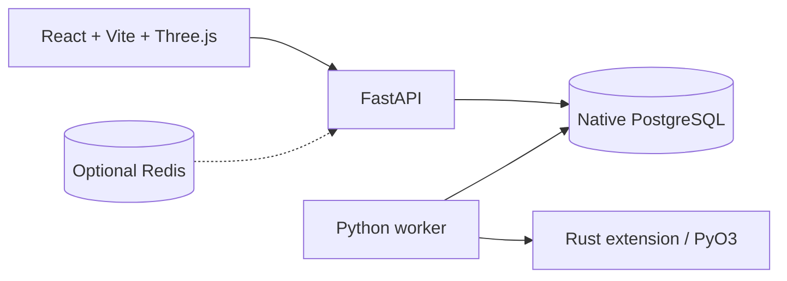
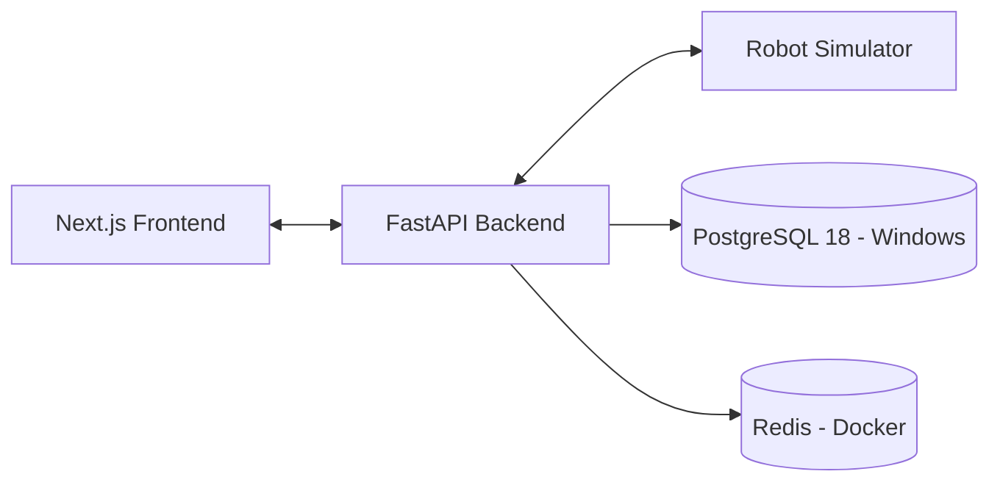

# Deployment Design — FleetOS

## 1. Status

**Local development topology documented and used.** Public production deployment, authentication, durable scheduling ownership, backups, monitoring and safe physical integration are **not implemented**.

## 2. Windows development topology

| Service | Current setup | Address |
|---|---|---|
| React/Vite | Node.js on Windows | `http://127.0.0.1:5173` |
| FastAPI | Pixi/Uvicorn on Windows | `http://127.0.0.1:8000` |
| PostgreSQL | Native Windows PostgreSQL 18 | `localhost:5432` |
| Rust scheduler | In-process PyO3 extension built by Maturin | Inside Python process |
| Autonomous worker | One Python asyncio loop, possibly started by FastAPI lifespan | No separate HTTP port |
| Redis | Optional future Docker service | Not needed for current prototype |



## 3. Prerequisites

Git, Pixi, Rust toolchain, PostgreSQL, Node.js. The original setup minimizes local Docker load by keeping PostgreSQL native and running optional Redis separately. The current file inventory confirms `pixi.toml`, `pixi.lock`, `crates/fleet-scheduler/Cargo.toml` and `frontend/package.json`. It does **not** list `.env.example`; add a sanitized template if needed. Never commit `.env`.

## 4. First-time installation

```powershell
git clone https://github.com/HamzaAhmedKhan786/robotics-fleet-manager.git
cd robotics-fleet-manager
pixi install
if (Test-Path .env.example) { if (-not (Test-Path .env)) { Copy-Item .env.example .env } } else { Write-Host "No .env.example found; create .env based on apps/backend/core/config.py without committing credentials." }
```

Configure correct local DB secrets in `.env`. Example non-secret flags:

```dotenv
APP_ENV=development
POSTGRES_DB=robotics_fleet
SIMULATION_ENABLED=true
SIMULATION_TICK_SECONDS=1
```

Create the databases separately (`robotics_fleet`, `robotics_fleet_test`). Run production/dev migration first:

```powershell
$env:POSTGRES_DB = 'robotics_fleet'
pixi run alembic upgrade head
pixi run maturin develop --manifest-path crates/fleet-scheduler/Cargo.toml
pixi run backend
```

Acknowledge the Uvicorn `--reload` process is a development server. Only one active worker should process the queue. If the FastAPI lifespan starts the worker, do not also start `scripts.auto_worker` manually. If lifespan does not start it, run `pixi run python -m scripts.auto_worker` in one extra terminal.

Start UI in a separate terminal:

```powershell
cd frontend
npm install
npm run dev
```

Check `/health`, `/docs`, `/api/v1/fleet/summary`, and `/api/v1/system/dispatcher` if available. The dashboard polls the API periodically, rather than depending on production WebSocket infrastructure.

## 5. Testing installation

```powershell
$env:POSTGRES_DB = 'robotics_fleet_test'
pixi run alembic upgrade head
Remove-Item Env:POSTGRES_DB
pixi run pytest tests -q --tb=short
pixi run ruff check apps tests scripts alembic
pixi run pyright apps/backend
cd frontend
npm run build
```

Test DB fixtures may truncate the test database; never use a production DB to run integration tests.

## 6. Optional Redis

Redis is not required to run the current local simulation. If/when integrated, `docker compose up -d redis` can start a standalone container; avoid starting a second PostgreSQL container that conflicts with the native server on 5432. Verify Redis features with integration tests before labeling them operational.

## 7. Production design — future

- Containerized UI and API, managed PostgreSQL with backups and tested restores.
- Separate durable worker service with leader election or exclusive queue ownership (no duplicated FastAPI-lifespan workers).
- Authenticated/authorized APIs, TLS, ingress, structured logs, metrics, tracing and alerts.
- Encrypted secrets, least-privilege DB users, explicit migration/rollback procedures.
- Persistent authoritative robot positions and idempotent mission completion.
- Optional Redis/event broker for streaming updates, without becoming the state authority.
- Rate-limits, API audit logs, network boundaries, failure recovery drills and capacity tests.

## 8. Physical robot boundary

No physical AMR should be connected without independent local safety control and validation. ROS 2/MQTT adapters are future possibilities, not present deployment dependencies.

See [Local Infrastructure ADR](ADR/0002-LOCAL-DEVELOPMENT-INFRASTRUCTURE.md).

---

## Original specification retained for traceability (historical baseline)

> **Historical reference, not a statement of current implementation.** The original text below is preserved so that no early requirement, design option, setup explanation, or proposed feature is lost. Where it differs from the current sections above, **the current sections take precedence**. In particular, references to Next.js, 20 robots, WebSocket telemetry, continuous movement, Redis integration, A* navigation, authentication, or physical control may describe earlier proposals rather than implemented behavior. Review original setup commands against the current repository before running them.

# Deployment Design

## 1. Development Environment

Robotics Fleet Manager supports a hybrid local development environment designed to reduce resource consumption on Windows machines.

The local environment uses:

- **Pixi:** Python environment and dependency management.
- **Node.js:** Next.js frontend development (planned).
- **PostgreSQL 18:** Native Windows service for persistent data storage.
- **Redis:** Dedicated Docker container for caching and temporary state (planned).
- **FastAPI:** Backend development server running through Pixi.
- **Python:** Robot simulation and fleet scheduling.

The logical system architecture remains independent of the infrastructure deployment method.

## 2. Local Architecture



The diagram represents the intended local architecture. The FastAPI starter is operational, PostgreSQL connectivity has been verified, and the remaining integrations will be implemented incrementally.

### Local Services

| Component | Execution environment | Configuration |
|---|---|---|
| FastAPI backend | Windows / Pixi | `127.0.0.1:8000` |
| PostgreSQL | Native Windows service | `localhost:5432` |
| Redis | Docker container | `localhost:6379` |
| Robot simulator | Windows / Pixi | Python process |
| Frontend | Windows / Node.js | Development server |

## 3. Environment Variables

The local `.env` configuration includes:

- `DATABASE_URL`
- `POSTGRES_HOST`
- `POSTGRES_PORT`
- `POSTGRES_DB`
- `POSTGRES_USER`
- `POSTGRES_PASSWORD`
- `REDIS_URL`
- `APP_ENV`
- `LOG_LEVEL`
- `CORS_ORIGINS`
- `JWT_SECRET`
- `JWT_ALGORITHM`

Copy `.env.example` to `.env` and configure the appropriate local values.

The `.env` file, database passwords, JWT secrets, and other sensitive credentials must never be committed to source control.

Authentication and database integration will be implemented in subsequent development phases.

## 4. Local Infrastructure Setup

### 4.1 PostgreSQL — Native Windows Service

The primary development environment uses an existing PostgreSQL 18 installation rather than running a second PostgreSQL instance in Docker.

Development setup:

1. Ensure the PostgreSQL Windows service is running.
2. Connect using the existing PostgreSQL administrator credentials.
3. Create the `robotics_fleet` database.
4. Configure the PostgreSQL credentials in `.env`.
5. Verify connectivity using Python and `asyncpg`.

PostgreSQL connectivity to the `robotics_fleet` database has been successfully verified.

A dedicated, restricted database user is recommended before production deployment.

### 4.2 Redis — Docker Container

Redis is planned to run in a dedicated Docker container.

Only the Redis service needs to be started for the hybrid local development setup.

```powershell
docker compose up -d redis
```

Verify Redis connectivity:

```powershell
docker compose exec redis redis-cli ping
```

Expected response:

```text
PONG
```

Redis is not yet integrated with the application.

Docker Desktop resource usage should be monitored because the development machine has 8 GB RAM.

### 4.3 FastAPI Backend

Install dependencies:

```powershell
pixi install
```

Start the backend:

```powershell
pixi run backend
```

Available starter endpoints:

- `http://127.0.0.1:8000/health`
- `http://127.0.0.1:8000/docs`
- `http://127.0.0.1:8000/api/v1/fleet/summary`

The fleet summary currently returns placeholder data. Persistent robot records and mission scheduling are not yet implemented.

### 4.4 Containerization Strategy

The repository retains Docker Compose configuration for PostgreSQL and Redis.

Two development approaches are supported by the infrastructure design:

**Hybrid Windows development**

- PostgreSQL runs natively on Windows.
- Redis runs in Docker.
- FastAPI and the simulator run through Pixi.

**Fully containerized infrastructure**

- PostgreSQL and Redis run through Docker Compose.
- Backend, frontend, and simulator containers may be added later.

This separation allows developers to select an appropriate deployment method without changing the core application architecture.

## 5. Production Architecture

A future production deployment may use:

- Containerized frontend and backend
- Managed PostgreSQL
- Managed Redis
- TLS-enabled ingress
- Centralized logging
- Metrics and alerting
- Automated backups

Production services should use dedicated credentials, encrypted connections, and appropriate access controls.

## 6. CI/CD

Proposed process:

1. Push changes to GitHub.
2. Run static analysis.
3. Run unit tests.
4. Run integration tests.
5. Build application containers.
6. Perform security checks.
7. Deploy to staging.
8. Run smoke tests.
9. Approve production deployment.

## 7. Recovery

Document:

- Database backup and restore
- Service restart behavior
- Simulator recovery
- Mission reconciliation
- Rollback procedures

## 8. Deployment Status

### Completed

- Pixi development environment configured.
- FastAPI starter application running.
- PostgreSQL 18 database created locally.
- PostgreSQL connectivity verified using `asyncpg`.
- Local environment variables configured.

### Planned

- SQLAlchemy database integration.
- Alembic database migrations.
- Redis container startup and connectivity verification.
- Robot registry and mission persistence.
- Robot simulation and scheduling.
- Frontend implementation.
- Containerized production deployment.

Production deployment is not implemented in the initial project phase.

For the rationale behind the local infrastructure configuration, see [ADR 0002 — Local Development Infrastructure](ADR/0002-LOCAL-DEVELOPMENT-INFRASTRUCTURE.md).
