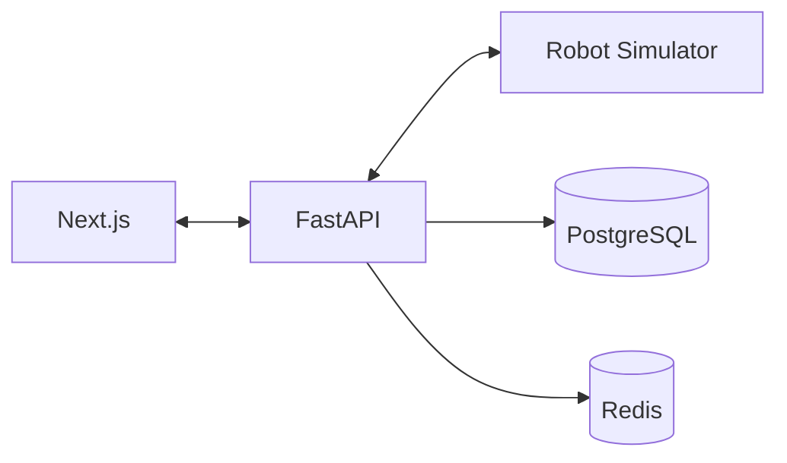

# Deployment Design

## 1. Development Environment

The local environment uses:
- Pixi for Python dependencies
- Node.js for Next.js
- Docker Compose for PostgreSQL and Redis
- FastAPI development server
- Python robot simulator

## 2. Local Architecture

## 3. Environment Variables

Required configuration:
- DATABASE_URL
- REDIS_URL
- APP_ENV
- LOG_LEVEL
- CORS_ORIGINS

Secrets must not be committed.

## 4. Containerization

The initial Compose environment will provide PostgreSQL and Redis.

Backend, frontend, and simulator containers may be added after the applications are functional.

## 5. Production Architecture

A future deployment may use:
- Containerized frontend and backend
- Managed PostgreSQL
- Managed Redis
- TLS-enabled ingress
- Centralized logging
- Metrics and alerting
- Automated backups

## 6. CI/CD

Proposed process:

1. Push changes to GitHub.
2. Run static analysis.
3. Run unit tests.
4. Run integration tests.
5. Build application containers.
6. Perform security checks.
7. Deploy to staging.
8. Run smoke tests.
9. Approve production deployment.

## 7. Recovery

Document:
- Database backup and restore
- Service restart behavior
- Simulator recovery
- Mission reconciliation
- Rollback procedures

## 8. Deployment Status

Production deployment is not implemented in the initial project phase.
