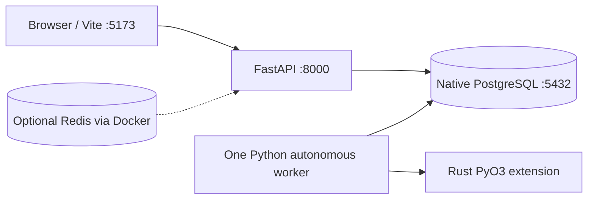

# ADR-0002 — Local Development Infrastructure

**Status:** Accepted; implementation notes updated 2026-11-07  
**Original date:** 2026-11-05

## Context

FleetOS is developed on Windows and needs local FastAPI, PostgreSQL, a compiled Rust module and a React/Vite development server. A prior environment assessment aimed to reduce Docker Desktop and WSL2 memory overhead. Native PostgreSQL 18 is already installed in the original developer configuration; the previous ADR noted an 8 GB RAM environment, but this is not a universal minimum or maximum.

## Decision

- Keep PostgreSQL as a **native Windows service** for the primary local setup.
- Use **Pixi** for Python 3.12, FastAPI, testing and Maturin.
- Compile `crates/fleet-scheduler` using **Rust + PyO3/Maturin** into the Pixi Python environment.
- Run **React/TypeScript/Vite** with Node/npm in its `frontend/` directory.
- Run one Python autonomous worker, integrated into FastAPI lifespan **or** separately, not both. No multi-worker production claim.
- Make Redis optional (single Docker service only when a feature actually requires it).
- Keep `compose.yaml` for alternative local infrastructure; don't accidentally start a second PostgreSQL instance on port 5432.
- Store local credentials in `.env`, not committed files.

## Local topology



## Setup outline

```powershell
pixi install
$env:POSTGRES_DB = 'robotics_fleet'
pixi run alembic upgrade head
pixi run maturin develop --manifest-path crates/fleet-scheduler/Cargo.toml
pixi run backend
```

Second terminal:

```powershell
cd frontend
npm install
npm run dev
```

For tests, create and migrate the separate `robotics_fleet_test` database. This avoids the test fixture deleting development records.

## Alternatives considered

- **All-in-Docker Compose:** consistent but higher local resource overhead; viable for CI/staging later.
- **All-native Windows services:** avoids Docker but increases platform-specific dependencies for optional Redis.
- **Managed cloud database:** adds costs/network dependency, unnecessary for local demonstration.
- **SQLite:** easier setup, but inappropriate substitute for current PostgreSQL locking and test requirements.

## Consequences and limitations

The developer must ensure native PostgreSQL is running and must manage Rust and Node toolchains. Application availability does not guarantee the autonomous worker is healthy; inspect `/api/v1/system/dispatcher` where present. The local development layout is **not** a secure production reference architecture.

## Revisit conditions

When collaborative development, CI/CD, production deployment, multi-worker scheduling or native performance workloads justify containerized or managed services.

---

## Original specification retained for traceability (historical baseline)

> **Historical reference, not a statement of current implementation.** The original text below is preserved so that no early requirement, design option, setup explanation, or proposed feature is lost. Where it differs from the current sections above, **the current sections take precedence**. In particular, references to Next.js, 20 robots, WebSocket telemetry, continuous movement, Redis integration, A* navigation, authentication, or physical control may describe earlier proposals rather than implemented behavior. Review original setup commands against the current repository before running them.

# ADR 0002 — Local Development Infrastructure

**Status:** Accepted

**Date:** 2026-11-05

## Context

Robotics Fleet Manager requires persistent PostgreSQL storage and plans to use Redis for temporary state and event distribution.

The primary development machine runs Windows 11 with 8 GB RAM. Running a full Docker Desktop development stack can cause resource contention and reduced responsiveness.

PostgreSQL 18 is already installed locally, and connectivity to the `robotics_fleet` database has been verified.

## Decision

Adopt a hybrid local development setup:

- Run FastAPI and the robot simulator through Pixi.
- Use the existing native PostgreSQL installation.
- Run Redis as a standalone Docker service when required.
- Retain Docker Compose configuration for reproducible infrastructure.
- Keep environment-specific connection settings outside application business logic.

## Alternatives considered

### Full Docker Compose stack

Provides consistent containerized infrastructure but introduces additional resource overhead on the development machine.

### Entirely native Windows services

Avoids Docker overhead but introduces additional installation and compatibility requirements for Redis.

### Managed cloud infrastructure

Reduces local resource usage but introduces network dependencies, external service configuration, and potential costs.

### SQLite instead of PostgreSQL

Simplifies local setup but differs from the intended PostgreSQL transaction and concurrency behavior used by the fleet management system.

## Consequences

### Benefits

- Reuses the existing PostgreSQL installation.
- Avoids running duplicate database servers.
- Preserves the planned application architecture.
- Supports development on resource-constrained hardware.
- Allows containerized infrastructure in other environments.

### Trade-offs

- Local infrastructure is not identical to a fully containerized deployment.
- Docker Desktop still introduces overhead when Redis is running.
- Developers must ensure PostgreSQL is running separately.
- Additional integration testing may be required to validate deployment-specific behavior.

## Review criteria

Revisit this decision if the development environment changes, the application requires additional infrastructure services, or container-based development becomes practical.
